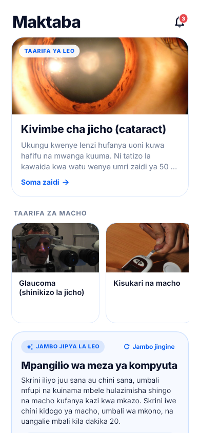
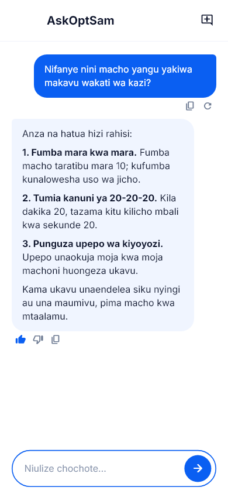
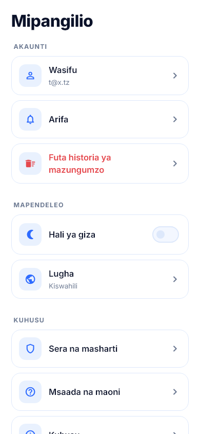
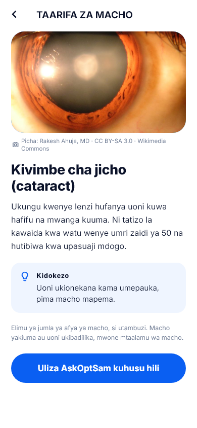

<p align="center">
  
</p>

<h1 align="center">AskOptSam</h1>

<p align="center">
  <b>Seeing Is Believing.</b><br />
  A Kiswahili-first eye-health assistant for Android — chat, daily eye facts,
  real photographs and free eye-care guidance.
</p>

<p align="center">
  <a href="https://github.com/galaxymushi/askoptsam-app/releases/latest"></a>
  <a href="https://github.com/galaxymushi/askoptsam-app/releases/latest/download/app-release.apk"></a>
  
  
  
</p>

<p align="center">
  <a href="#download">Download</a> ·
  <a href="#features">Features</a> ·
  <a href="#screenshots">Screenshots</a> ·
  <a href="#build-it-yourself">Build</a> ·
  <a href="#release-process">Releases</a> ·
  <a href="#kiswahili">Kiswahili</a>
</p>

---

AskOptSam is a Flutter Android app built for Optsam Eye Care. It answers
everyday eye-health questions in **Kiswahili or English**, teaches with
**28 daily eye facts** (each with a real, openly-licensed photograph), and
keeps users updated with a **daily AI briefing** and **real status-bar
notifications**.

> **Not a medical device.** AskOptSam gives general eye-health information
> only. It does not diagnose, prescribe or replace an optometrist. For an
> emergency (chemical splash, sudden vision loss, penetrating injury) go to a
> clinic immediately.

## Download

| | |
| --- | --- |
| **Latest APK** | [**galaxymushi/askoptsam-app/releases/latest**](https://github.com/galaxymushi/askoptsam-app/releases/latest/download/app-release.apk) |
| **All releases** | [Releases page](https://github.com/galaxymushi/askoptsam-app/releases) |
| **Current version** | **2.3.6** (`versionCode 12`) — APK ≈ 38 MB |
| **SHA-256 (2.3.6)** | `85d5290dfb53570bd5eef1a0f6de11ac12bc10f981f21567a199138a4a97bf32` |
| **Support** | optsamtz@gmail.com |

Install the APK, allow "install from unknown sources" if Android asks, and
open the app. The app checks GitHub Releases on launch: if a newer version
exists it shows a **blocking update dialog** — download the newest APK to
continue (the download button disappears for that version once fetched).

## Features

- **Chat with AskOptSam** — an eye-health assistant that replies in the
  language you write in (Kiswahili / English), with citation markers stripped
  from replies so answers read cleanly.
- **Suggestion chips that stay on topic** — one daily briefing question plus
  three common eye questions that rotate every day ("Kwa nini macho
  yanakauka mbele ya skrini?", "Je, macho mekundu ni hatari?", …).
- **Maktaba (Library)** — 28 eye facts on a 28-day cycle, each with a real
  Wikimedia photograph, photographer credit and licence.
- **Jambo jipya la leo (Daily briefing)** — 16 seeded briefings on a 16-day
  cycle, generated with AI and cached for the day.
- **Real notifications** — status-bar notifications via
  `flutter_local_notifications` (tips, replies, welcome, new releases) with
  an in-app notification centre and unread badge.
- **Forced updates** — a modal gate with `barrierDismissible: false` that
  keeps the app usable if GitHub is unreachable (never locks you out
  offline).
- **Accounts, optional** — sign in with email or use the app locally; chats
  are stored on-device and synced only when a cloud account is used.
- **Bilingual + dark mode** — full Kiswahili / English UI and a real dark
  theme, both persisted.
- **The mascot** — OptSam's big-eyed mascot floats, blinks and follows your
  finger (`GazeScope`) — which is why the top of the chat screen stays clear.

### What is *not* in the app

Payments (Airtel Money / M-Pesa), donations and "buy a coffee" were removed
completely in 2.3.5. AskOptSam asks for no PIN, OTP or card details, ever.

## Screenshots

| Library (Maktaba) | Chat (AskOptSam) |
| --- | --- |
|  |  |

| Settings (Mipangilio) | Eye fact of the day |
| --- | --- |
|  |  |

Dark mode and more shots live in [`asksam/test/goldens/`](asksam/test/goldens/)
(regenerate with `flutter test test/capture_screens.dart --update-goldens`).

## Tech stack

| Layer | Choice |
| --- | --- |
| Framework | Flutter (Dart SDK ^3.13.7) — Android only |
| AI | Hosted AskOptsam assistant (`askoptsam` protocol) or any OpenAI-compatible API |
| Backend | Firebase Auth + Cloud Firestore (optional; app works fully offline without them) |
| Notifications | `flutter_local_notifications` (real status-bar notifications) |
| Local storage | `shared_preferences` + on-device chat store |
| UI | Custom design system, Inter font, hand-drawn CustomPainter mascot |
| Releases | Signed APK published to GitHub Releases |

### Project layout

```
asksam/
├── lib/
│   ├── main.dart              # bootstrap, UpdateGate, GazeScope
│   ├── config.dart            # all build-time --dart-define values
│   ├── l10n.dart              # Kiswahili + English strings (single source)
│   ├── theme.dart, app_state.dart, models.dart
│   ├── screens/               # 14 screens (chat, library, settings, …)
│   ├── services/              # ai, auth, chat store, notifications,
│   │                          # daily intelligence, settings, updates
│   ├── content/               # 28 eye facts + photos + legal text
│   └── widgets/               # UI kit, mascot, gaze, update gate
└── test/                      # 23 tests + screenshot goldens
```

## Build it yourself

```powershell
# Windows: point Gradle at a JDK 17
$env:JAVA_HOME = "C:\path\to\jdk-17"

flutter pub get
flutter build apk --release --obfuscate --split-debug-info=build/symbols
# → build\app\outputs\flutter-apk\app-release.apk
```

The release build ships **only `armeabi-v7a` + `arm64-v8a`** (see `ndk.abiFilters`
in `android/app/build.gradle.kts`). The emulator-only `x86_64` libraries are
excluded — they used to add ~19 MB to every update download.

### Configuration (all optional `--dart-define`s)

| Define | Purpose | Default |
| --- | --- | --- |
| `AI_PROTOCOL` | `askoptsam` (hosted assistant) or `openai` | `askoptsam` |
| `AI_BASE_URL` | Assistant endpoint | hosted AskOptsam assistant |
| `AI_API_KEY`, `AI_MODEL` | Required only for `openai` protocol | — |
| `FIREBASE_API_KEY`, `FIREBASE_APP_ID`, … | Cloud sync + accounts | — (local-only build) |
| `SUPPORT_EMAIL` | Help & feedback | `optsamtz@gmail.com` |
| `RELEASES_API_URL`, `LATEST_APK_URL` | Update checks | this repo's releases |

Without Firebase defines the app runs fully local; without an AI key the chat
screen says so instead of failing.

### Checks before every release

```powershell
flutter analyze          # must be "No issues found"
flutter test             # 23 tests, all green
```

## Release process

1. Bump `version:` in `asksam/pubspec.yaml` (`x.y.z+N`) and
   `_fallbackInstalledVersion` in `lib/services/update_service.dart`.
2. `flutter analyze` + `flutter test`.
3. Commit, push, then build the signed APK (command above).
4. Verify with `aapt dump badging` (`versionName` / `versionCode`) and compute
   `Get-FileHash app-release.apk -Algorithm SHA256`.
5. Create the GitHub release (Kiswahili notes + SHA-256) and upload
   `app-release.apk`.
6. Confirm `releases/latest` resolves to the new tag **without a token** —
   that is what in-app update checks hit.

### Version history

| Version | Highlights |
| --- | --- |
| **2.3.6** | APK shrunk 59 MB → 38 MB (arm-only ABIs); on-topic eye-question suggestion chips |
| 2.3.5 | Payments removed entirely; founders' names fixed; chat update bar moved to the bottom; tabs reordered |
| 2.3.4 | Download button retires per version after fetching |
| 2.3.3 | Blocking force-update gate |
| 2.3.2 | 8 more eye facts (28 total) with licensed photos |
| 2.3.1 | Citation markers stripped from replies |
| 2.3.0 | In-app update notification + one-tap download |
| 2.2.0 | Real photographs on every library fact |
| 2.1.0 | First signed APK release |

## Contributors

<p>
  <b>J.M. SAMWEL</b> — Founder · <b>J.M. EMANUELI</b> — Co-founder
</p>

Questions, bugs or feedback: **[optsamtz@gmail.com](mailto:optsamtz@gmail.com)**

Companion project: **[askoptsam](https://github.com/galaxymushi/askoptsam)** —
the bilingual web version (Astro).

---

## Kiswahili

AskOptSam ni programu ya Android inayotumia **Kiswahili na Kiingereza**
kujibu maswali ya afya ya macho, kuelimisha kwa **ukweli 28 wa macho**
(kila siku mpya, kila mmoja na picha halisi leseni huria), na kutuma
**arifa halisi** kwenye upau wa hali ya simu.

**Pakua hapa:** [galaxymushi/askoptsam-app/releases/latest](https://github.com/galaxymushi/askoptsam-app/releases/latest/download/app-release.apk)

**Vipengele:** chat ya macho · vidokezo vya maswali ya macho vinavyobadilishana
kila siku · Maktaba (ukweli 28 + picha) · Jambo jipya la leo (16) · arifa za
simu · sasisho la lazima · Kiswahili/Kiingereza · hali ya giza ·
mascot inayofuata kidole chako.

**Hali ya usalama:** AskOptSam **haitoi malipo yoyote** tena (Airtel/M-Pesa
zimeondolewa kabisa tangu 2.3.5), haombi PIN wala OTP, na **si kifaa cha
tibabu** — kwa dharura (kemikali, upungufu wa ghafla wa kuona) nenda
kliniki mara moja.

**Mwanzilishi:** J.M. SAMWEL · **Mwanzilishi mwenza:** J.M. EMANUELI ·
**Msaada:** [optsamtz@gmail.com](mailto:optsamtz@gmail.com)
