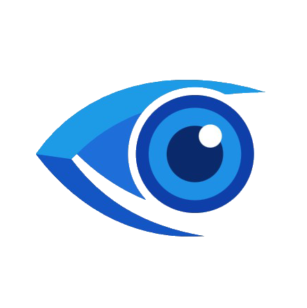
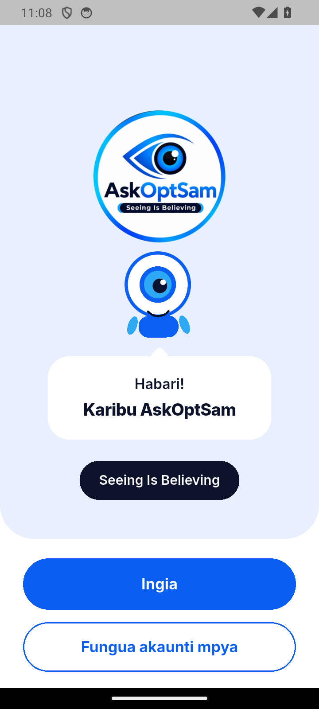
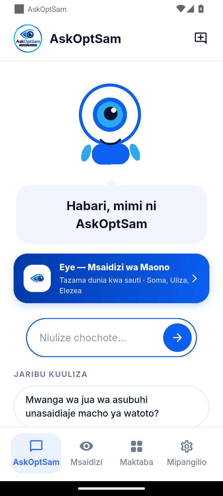
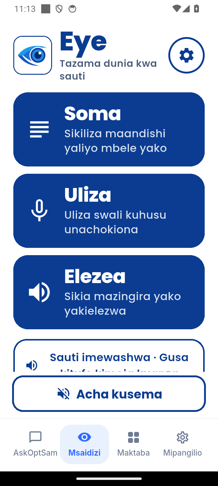
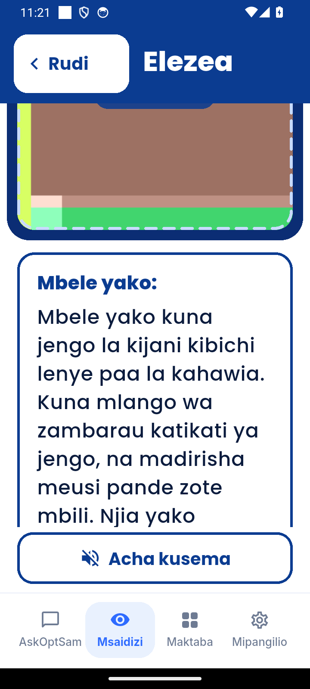
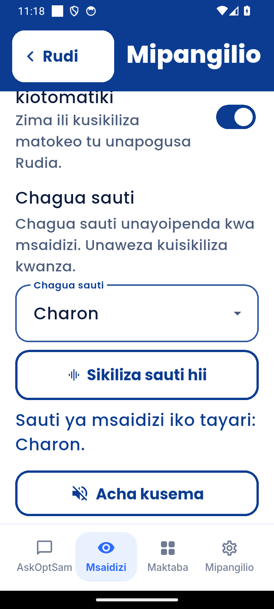

<p align="center">
  
  &nbsp;&nbsp;&nbsp;&nbsp;
  
</p>

<h1 align="center">AskOptSam &middot; Eye (Msaidizi wa Maono)</h1>

<p align="center">
  <b>Seeing Is Believing &mdash; Tazama Dunia kwa Sauti</b><br />
  A Kiswahili-first AI Optometry &amp; Low-Vision Accessibility Suite for Android, built for <b>Optsam Eye Care</b>.
</p>

<p align="center">
  <a href="https://github.com/galaxymushi/askoptsam-eye/releases/latest">
    
  </a>
  <a href="https://github.com/galaxymushi/askoptsam-eye/releases/download/v2.4.7/app-release.apk">
    
  </a>
  
  
  
</p>

<p align="center">
  <a href="#-download--install">Download</a> &bull;
  <a href="#-screenshots">Screenshots</a> &bull;
  <a href="#-key-features">Features</a> &bull;
  <a href="#-eye--msaidizi-wa-maono">Eye Vision Assistant</a> &bull;
  <a href="#-ai--voice-architecture">AI &amp; Voice</a> &bull;
  <a href="#-project-structure">Architecture</a> &bull;
  <a href="#-build--test">Build from Source</a> &bull;
  <a href="#-maelezo-kwa-kiswahili">Kiswahili</a>
</p>

---

## Overview

**AskOptSam** is a unified Android application built for **Optsam Eye Care (Dar es Salaam, Tanzania)** that brings together two core experiences in a single accessible mobile app:

1. **AskOptSam Optometry Assistant** — Interactive bilingual (Kiswahili & English) eye-health consultation, an autonomous daily eye-care briefing (**Jambo Jipya la Leo**), and a curated **28-day Eye Health Library (Maktaba)** featuring real, openly-licensed clinical and anatomical photographs.
2. **Eye &middot; Msaidizi wa Maono** — A high-contrast, voice-guided camera assistant engineered for blind and low-vision users. Powered by **Gemini 2.5 Flash** vision (`gemini-2.5-flash`) and **Gemini Neural Text-to-Speech** (`gemini-2.5-flash-preview-tts`), it reads printed text aloud (**Soma**), answers spoken or typed questions about what is in front of the camera (**Uliza**), and narrates real-time spatial descriptions for safe navigation (**Elezea**).

> [!IMPORTANT]
> **Medical Disclaimer:** AskOptSam provides general optometry and eye-health education and visual assistance. It is not a medical diagnostic device and does not replace a comprehensive eye exam by a licensed optometrist or ophthalmologist. For ocular emergencies (chemical splash, sudden vision loss, severe trauma), visit a clinic immediately.

---

## Download & Install

| Resource | Link / Details |
| :--- | :--- |
| **Direct APK (Primary)** | [**Download `app-release.apk` (v2.4.7)**](https://github.com/galaxymushi/askoptsam-eye/releases/download/v2.4.7/app-release.apk) |
| **Direct APK (Mirror)** | [**Download from `askoptsam-app` (v2.4.7)**](https://github.com/galaxymushi/askoptsam-app/releases/download/v2.4.7/app-release.apk) |
| **All Releases** | [GitHub Releases Page](https://github.com/galaxymushi/askoptsam-eye/releases) |
| **Latest Version** | `2.4.7` (`versionCode 20`) &bull; Universal Android APK (`arm64-v8a`, `armeabi-v7a`, `x86_64`) |
| **Minimum Android** | Android 7.0+ (API 24+) |
| **Support & Clinic** | [optsamtz@gmail.com](mailto:optsamtz@gmail.com) |

### Installation Steps
1. Tap the **Direct APK** link above on your Android phone to download `app-release.apk`.
2. Open the downloaded file and allow *"Install from this source"* if prompted by Android.
3. **Automatic Over-the-Air Updates:** Once installed, AskOptSam checks GitHub Releases automatically and notifies you both in the notification bell and via an in-app update dialog whenever a new version is published.

---

## Screenshots

| Welcome & Mascot | AskOptSam Hub | Eye &middot; Msaidizi wa Maono | Live Scene Description (`Elezea`) | Neural Voice Synthesis |
| :---: | :---: | :---: | :---: | :---: |
|  |  |  |  |  |
| Single-eye blinking Mascot &amp; bilingual onboarding | Optometry chat &amp; 1-tap **Eye** launcher | Large high-contrast tactile controls | Real-time camera + `gemini-2.5-flash` vision | 8 neural Gemini voices (`Charon`, `Kore`, etc.) |

---

## Key Features

### 1. AskOptSam Optometry Hub
- **Bilingual AI Eye Consultation:** Ask questions in Kiswahili or English and receive clear, structured optometry guidance with source citations automatically cleaned for readability.
- **Interactive Single-Eye Mascot:** Vector-drawn custom mascot (`CustomPainter`) that floats, breathes, blinks naturally, hops on tap, and tracks touch movement across the screen via `GazeScope`.
- **28-Day Eye Fact Library (`Maktaba`):** 28 rotating evidence-based eye facts, each paired with a real Wikimedia Commons photograph, photographer attribution, and license.
- **Autonomous Daily Briefing (`Jambo Jipya la Leo`):** Generates and caches a fresh daily eye-health insight tailored to the user's language.
- **Pre-Login Privacy Policy & Terms:** Full bilingual **Sera ya Faragha na Masharti** accessible directly from the Sign-In and Sign-Up screens prior to account creation.
- **In-App & Status-Bar Notifications:** Real Android notifications via `flutter_local_notifications` for daily eye tips and new APK updates.

### 2. Eye &middot; Msaidizi wa Maono (Low-Vision Assistant)
Built specifically for blind, low-vision, and elderly users with oversized touch targets (`76dp+`), full `Semantics` screen-reader annotations, haptic feedback cues, and three high-contrast visual themes (**High-Contrast Blue**, **Daylight White**, and **Yellow-on-Black Low Vision**):

- **Soma (Read Text):**
  - Point the camera at clinic signs, medicine bottles, prescriptions, books, or menus.
  - Transcribes every visible line accurately and reads it aloud automatically.
  - Includes one-tap **Tochi (Flashlight/Torch)** control for dim environments.
- **Uliza (Ask by Voice or Text):**
  - Hold or tap the microphone (`speech_to_text` with `sw-TZ` and `en-US` locales) or type a question about what is in front of the camera.
  - Answers concisely using clock-face directions (e.g., *"at 12 o'clock"*).
- **Elezea (Describe Scene & Continuous Guidance):**
  - Describes the path ahead in 2–4 clear sentences, prioritizing walking hazards: stairs, curbs, vehicles, obstacles, doorways, and signs.
  - Includes **Endelea (Continuous Auto-Describe)** mode that captures and narrates the surroundings every 6 seconds hands-free.

---

## AI & Voice Architecture

| Component | Model / Engine | Highlights |
| :--- | :--- | :--- |
| **Vision & OCR (`Soma`, `Uliza`, `Elezea`)** | `gemini-2.5-flash` | Configured with `thinkingBudget: 0` for ~1.5s–2.8s visual recognition latency; automatic fallback to `gemini-3.5-flash`. |
| **Neural Voice TTS (`GeminiVoice`)** | `gemini-2.5-flash-preview-tts` | Synthesizes natural 24 kHz 16-bit PCM WAV speech in Kiswahili &amp; English across 8 voices (`Charon`, `Kore`, `Puck`, `Aoede`, `Fenrir`, `Zephyr`, `Leda`, `Orus`) with LRU audio caching and `DeviceFileSource` playback. |
| **Offline Speech Fallback (`SpeechService`)** | Android `FlutterTts` | Instant offline fallback (`sw-TZ`, `sw-KE`, `en-US`) for urgent navigation cues or when offline. |
| **IPv4-Preferred Transport (`GeminiHttp`)** | Custom `dart:io` `HttpClient` | Bypasses broken mobile/ISP IPv6 (`AAAA`) routes by resolving IPv4 (`A`) records first (`<40ms` TLS handshake), preventing 20s socket timeouts on Android. |

---

## Project Structure

```text
askoptsam/
├── assets/
│   ├── branding/                  # AskOptSam & Eye (eye-mark.png) logos
│   ├── fonts/                     # Inter & Poppins font families
│   ├── images/facts/              # 28 licensed clinical/eye photographs
│   └── screenshots/               # Emulator-verified README screenshots
├── lib/
│   ├── main.dart                  # App bootstrap, GazeScope, UpdateGate
│   ├── config.dart                # Build-time configuration & release endpoints
│   ├── l10n.dart                  # AskOptSam Kiswahili & English strings
│   ├── eye/                       # Eye · Msaidizi wa Maono module
│   │   ├── theme.dart             # High-Contrast, Daylight & Low-Vision themes
│   │   ├── l10n/strings.dart      # Bilingual accessibility strings (SW/EN)
│   │   ├── screens/               # HomeScreen, ReadScreen, AskScreen, DescribeScreen, SettingsScreen
│   │   ├── services/              # GeminiService, GeminiVoice, GeminiHttp, SpeechService, AppSettings
│   │   └── widgets/               # EyeCameraBox, CameraShell, AccessibleScaffold, BigButton
│   ├── screens/                   # AppShell, ChatScreen, EyeAssistantScreen, LibraryScreen, Auth, Privacy
│   ├── services/                  # AiService, AuthService, UpdateService, LocalNotifications
│   └── widgets/                   # Mascot (single-eye vector painter), GazeScope, UpdateGate
└── test/                          # 27 automated widget & unit tests
```

---

## Build & Test

### Prerequisites
- **Flutter SDK:** `3.47.x` (Dart `^3.13.7`)
- **Java JDK:** OpenJDK `17`
- **Android SDK:** API `36` (`compileSdk 36`, `minSdk 24`)

### Run Analysis & Automated Tests
```powershell
flutter pub get
dart analyze lib test    # 0 issues
flutter test             # 27/27 tests passing
```

### Build Release APK
```powershell
$env:JAVA_HOME = "C:\path\to\jdk-17"
flutter build apk --release
# Output: build\app\outputs\flutter-apk\app-release.apk
```

---

## Version History

| Version | Release Highlights |
| :--- | :--- |
| **`v2.4.5`** | **Emulator-Verified AI & IPv4 Transport Fix:** Added `GeminiHttp` IPv4-preferred client fixing Android `dart:io` IPv6 timeouts; verified `gemini-2.5-flash` vision and `gemini-2.5-flash-preview-tts` voice synthesis live on Android emulator; universal APK (`arm64-v8a`, `armeabi-v7a`, `x86_64`). |
| `v2.4.4` | Restored original `eye-0.3.3` `gemini-2.5-flash` (`thinkingBudget: 0`) and `gemini-2.5-flash-preview-tts` voice pipeline with file-backed audio playback. |
| `v2.4.3` | Integrated full native **Eye 0.3.3** screens (`Soma`, `Uliza`, `Elezea`, `Mipangilio`), `Poppins` typography, `eye-mark.png` branding, and single big-eye blinking `Mascot`. |
| `v2.4.2` | Added clickable Privacy Policy & Terms links on Sign-In and Sign-Up screens prior to login. |
| `v2.4.0` | Unified **AskOptSam** and **Eye &middot; Msaidizi wa Maono** into a single 4-tab Android application. |

---

## Maelezo kwa Kiswahili

**AskOptSam** ni programu ya Android iliyotengenezwa kwa ajili ya **Optsam Eye Care (Dar es Salaam)** inayounganisha ushauri wa afya ya macho na msaidizi wa maono (**Eye &middot; Msaidizi wa Maono**):

1. **Soma (Read):** Elekeza kamera kwenye maandishi yoyote (bango, chupa ya dawa, risiti, au kitabu) na programu itayasoma kwa sauti safi ya Kiswahili au Kiingereza.
2. **Uliza (Ask):** Bonyeza kitufe cha kipaza sauti uulize swali lolote kuhusu kinachoonekana mbele ya kamera.
3. **Elezea (Describe):** Pata maelezo ya haraka kuhusu mazingira yaliyo mbele yako (ngazi, magari, milango, na vikwazo njiani) pamoja na chaguo la **Endelea** linaloelezea njia kila sekunde 6.
4. **Sauti za Asili za AI (`GeminiVoice`):** Chagua kati ya sauti 8 za AI (`Charon`, `Kore`, `Puck`, `Aoede`, `Fenrir`, `Zephyr`, `Leda`, `Orus`) na uzijaribu moja kwa moja kwenye **Mipangilio &rarr; Sikiliza sauti hii**.

---

## Authors & Contact

- **J.M. SAMWEL** — *Founder*
- **J.M. EMANUELI** — *Co-Founder*
- **Optsam Eye Care** — Dar es Salaam, Tanzania &bull; [optsamtz@gmail.com](mailto:optsamtz@gmail.com)
